<!--
  The blocks between start and end markers are rewritten by build/build.py, which
  .github/workflows/build.yml runs every day. Change build/profile.json, not the blocks.
-->

<a href="https://dranirbanchakraborty.com/"><picture><source media="(prefers-color-scheme: dark)" srcset="https://raw.githubusercontent.com/anirbanchakraborty-dev/anirbanchakraborty-dev/output/hero-dark.svg"></picture></a>

<picture><source media="(prefers-color-scheme: dark)" srcset="https://raw.githubusercontent.com/anirbanchakraborty-dev/anirbanchakraborty-dev/output/now-dark.svg"></picture>

<a href="https://dranirbanchakraborty.com/"><picture><source media="(prefers-color-scheme: dark)" srcset="https://raw.githubusercontent.com/anirbanchakraborty-dev/anirbanchakraborty-dev/output/link-website-dark.svg"></picture></a>&nbsp;
<a href="https://www.linkedin.com/in/dr-anirban-chakraborty/"><picture><source media="(prefers-color-scheme: dark)" srcset="https://raw.githubusercontent.com/anirbanchakraborty-dev/anirbanchakraborty-dev/output/link-linkedin-dark.svg"></picture></a>&nbsp;
<a href="https://scholar.google.com/citations?user=j2OEqZUAAAAJ&hl=en"><picture><source media="(prefers-color-scheme: dark)" srcset="https://raw.githubusercontent.com/anirbanchakraborty-dev/anirbanchakraborty-dev/output/link-scholar-dark.svg"></picture></a>&nbsp;
<a href="https://www.researchgate.net/profile/Anirban-Chakraborty-19"><picture><source media="(prefers-color-scheme: dark)" srcset="https://raw.githubusercontent.com/anirbanchakraborty-dev/anirbanchakraborty-dev/output/link-researchgate-dark.svg"></picture></a>&nbsp;
<a href="https://dranirbanchakraborty.com/feed.xml"><picture><source media="(prefers-color-scheme: dark)" srcset="https://raw.githubusercontent.com/anirbanchakraborty-dev/anirbanchakraborty-dev/output/link-rss-dark.svg"></picture></a>&nbsp;
<a href="https://dranirbanchakraborty.com/contact"><picture><source media="(prefers-color-scheme: dark)" srcset="https://raw.githubusercontent.com/anirbanchakraborty-dev/anirbanchakraborty-dev/output/link-contact-dark.svg"></picture></a>

### About

CPU microcode at Intel, after nearly two years of logic design for the power-management blocks of Intel SoCs. The research behind it is finite-field arithmetic and the hardware that computes it: scalable primitive-polynomial circuits over $\mathrm{GF}(2)$, greatest-common-divisor datapaths over $\mathrm{GF}(2^k)$, and the error-correcting codes and cryptography built on both, from a Ph.D. at the University of North Texas.

Outside the day job, the work here is open: free long-form books that build each subject up from first principles, a LilyPond toolkit for Neovim written in Rust and Lua, and a 32-bit CPU designed for teaching.

### Projects

<!-- projects:start -->

<a href="https://github.com/anirbanchakraborty-dev/swara"><picture><source media="(prefers-color-scheme: dark)" srcset="https://raw.githubusercontent.com/anirbanchakraborty-dev/anirbanchakraborty-dev/output/project-swara-dark.svg">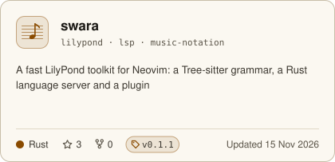</picture></a>
<a href="https://github.com/anirbanchakraborty-dev/ecc-book-lab"><picture><source media="(prefers-color-scheme: dark)" srcset="https://raw.githubusercontent.com/anirbanchakraborty-dev/anirbanchakraborty-dev/output/project-ecc-book-lab-dark.svg">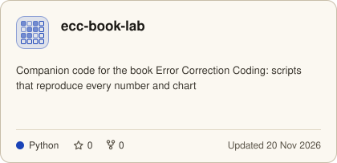</picture></a>

<a href="https://github.com/anirbanchakraborty-dev/ACH-NEOVIM"><picture><source media="(prefers-color-scheme: dark)" srcset="https://raw.githubusercontent.com/anirbanchakraborty-dev/anirbanchakraborty-dev/output/project-ach-neovim-dark.svg">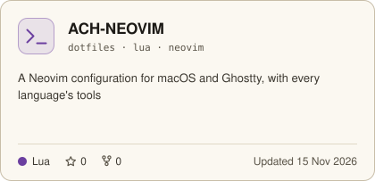</picture></a>
<a href="https://github.com/anirbanchakraborty-dev/Yantra-CPU"><picture><source media="(prefers-color-scheme: dark)" srcset="https://raw.githubusercontent.com/anirbanchakraborty-dev/anirbanchakraborty-dev/output/project-yantra-cpu-dark.svg">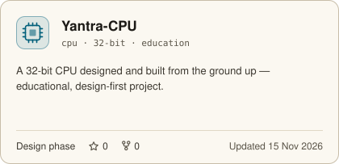</picture></a>

<a href="https://github.com/anirbanchakraborty-dev/tree-sitter-lilypond"><picture><source media="(prefers-color-scheme: dark)" srcset="https://raw.githubusercontent.com/anirbanchakraborty-dev/anirbanchakraborty-dev/output/project-tree-sitter-lilypond-dark.svg">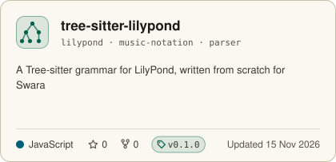</picture></a>
<a href="https://github.com/anirbanchakraborty-dev/Post-Mac-Setup"><picture><source media="(prefers-color-scheme: dark)" srcset="https://raw.githubusercontent.com/anirbanchakraborty-dev/anirbanchakraborty-dev/output/project-post-mac-setup-dark.svg">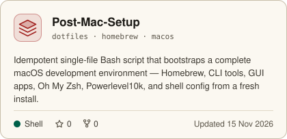</picture></a>

<!-- projects:end -->

### Books

Free to read on [dranirbanchakraborty.com](https://dranirbanchakraborty.com/). Four books build their subject from first principles, and a field guide covers the Nikon Z6III. The chapter counts come from the site's feed, so they rise as chapters are published.

<!-- books:start -->

<a href="https://dranirbanchakraborty.com/learn/computer-architecture"><picture><source media="(prefers-color-scheme: dark)" srcset="https://raw.githubusercontent.com/anirbanchakraborty-dev/anirbanchakraborty-dev/output/book-pipeline-dark.svg">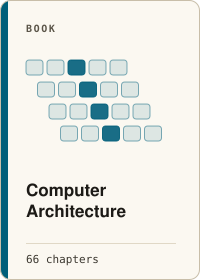</picture></a>
<a href="https://dranirbanchakraborty.com/learn/hardware-interview-prep"><picture><source media="(prefers-color-scheme: dark)" srcset="https://raw.githubusercontent.com/anirbanchakraborty-dev/anirbanchakraborty-dev/output/book-timing-dark.svg">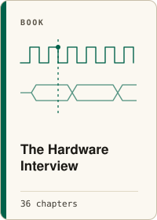</picture></a>
<a href="https://dranirbanchakraborty.com/learn/post-quantum-cryptography"><picture><source media="(prefers-color-scheme: dark)" srcset="https://raw.githubusercontent.com/anirbanchakraborty-dev/anirbanchakraborty-dev/output/book-lattice-dark.svg">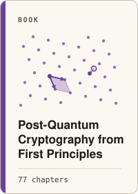</picture></a>
<a href="https://dranirbanchakraborty.com/learn/error-correction-coding"><picture><source media="(prefers-color-scheme: dark)" srcset="https://raw.githubusercontent.com/anirbanchakraborty-dev/anirbanchakraborty-dev/output/book-parity-dark.svg">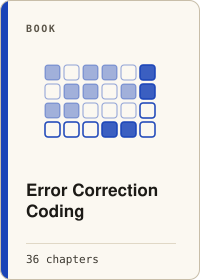</picture></a>
<a href="https://dranirbanchakraborty.com/photography/z6iii"><picture><source media="(prefers-color-scheme: dark)" srcset="https://raw.githubusercontent.com/anirbanchakraborty-dev/anirbanchakraborty-dev/output/book-aperture-dark.svg">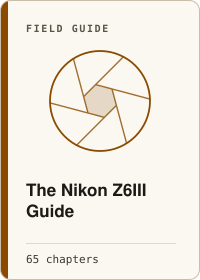</picture></a>

<!-- books:end -->

### Latest from the site

<!-- feed:start -->
- [Before You Start](https://dranirbanchakraborty.com/learn/error-correction-coding/ecc-before-you-start) · Error Correction Coding · 14 Nov 2026
- [Clock Generation, Distribution, Reset, and Domain Crossing](https://dranirbanchakraborty.com/learn/hardware-interview-prep/clocking-reset-and-domain-crossing) · The Hardware Interview · 10 Nov 2026
- [Introduction to Pipelining](https://dranirbanchakraborty.com/learn/computer-architecture/introduction-to-pipelining) · Computer Architecture · 10 Nov 2026
- [ACH-NEOVIM: My Neovim Configuration for macOS](https://dranirbanchakraborty.com/blog/ach-neovim) · Blog · 12 Oct 2026
- [Wildlife with a Long Telephoto](https://dranirbanchakraborty.com/photography/z6iii/recipe-wildlife) · The Nikon Z6III Guide · 5 Oct 2026
- [Start Here](https://dranirbanchakraborty.com/learn/post-quantum-cryptography/before-you-start) · Post-Quantum Cryptography from First Principles · 25 Aug 2026
<!-- feed:end -->

### Activity

<!-- activity:start -->

<picture><source media="(prefers-color-scheme: dark)" srcset="https://raw.githubusercontent.com/anirbanchakraborty-dev/anirbanchakraborty-dev/output/stats-dark.svg">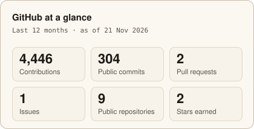</picture>
<picture><source media="(prefers-color-scheme: dark)" srcset="https://raw.githubusercontent.com/anirbanchakraborty-dev/anirbanchakraborty-dev/output/languages-dark.svg"></picture>

<picture><source media="(prefers-color-scheme: dark)" srcset="https://raw.githubusercontent.com/anirbanchakraborty-dev/anirbanchakraborty-dev/output/activity-dark.svg"></picture>

<picture><source media="(prefers-color-scheme: dark)" srcset="https://raw.githubusercontent.com/anirbanchakraborty-dev/anirbanchakraborty-dev/output/snake-dark.svg"></picture>

<!-- activity:end -->

### Merged upstream

<!-- prs:start -->
- [rockerBOO/awesome-neovim#2598](https://github.com/rockerBOO/awesome-neovim/pull/2598): Add `anirbanchakraborty-dev/swara` · merged 13 Nov 2026
- [pwntester/octo.nvim#1470](https://github.com/pwntester/octo.nvim/pull/1470): fix(fzf-lua): set kind="repo" on preview buffer before render · merged 22 Apr 2026
<!-- prs:end -->

### Toolbox

<!-- toolbox:start -->
<picture><source media="(prefers-color-scheme: dark)" srcset="https://raw.githubusercontent.com/anirbanchakraborty-dev/anirbanchakraborty-dev/output/toolbox-dark.svg"></picture>
<!-- toolbox:end -->

### Research

Seven papers between 2015 and 2022, and a dissertation on algorithms and hardware for the arithmetic inside cryptography and error-correction coding. The full record is on [Google Scholar](https://scholar.google.com/citations?user=j2OEqZUAAAAJ&hl=en).

Publications

- **Dissertation, 2022.** Novel Algorithms and Hardware Architectures for Computational Subsystems Used in Cryptography and Error Correction Coding. University of North Texas. [doi:10.12794/metadc1986304](https://doi.org/10.12794/metadc1986304)
- **IEEE DCAS, 2022.** Area and Power analysis of a Scalable Primitive Polynomial computation circuit over the field $\mathrm{GF}(2)$. [doi:10.1109/DCAS53974.2022.9845656](https://doi.org/10.1109/DCAS53974.2022.9845656)
- **IEEE DCAS, 2022.** Power, Performance, and Area Analysis of Hardware Design Techniques for $\mathrm{GF}(2^k)$ Greatest Common Divisor computation. [doi:10.1109/DCAS53974.2022.9845594](https://doi.org/10.1109/DCAS53974.2022.9845594)
- **Book chapter, 2022.** Evolution of the Internet of Things and Fundamentals of Human-Machine Interaction. [doi:10.1201/9781003268796-2](https://doi.org/10.1201/9781003268796-2)
- **European Scientific Journal, 2021.** Improving Learning Experience of People with Cognitive Disabilities Using Serious Games: A Review. [doi:10.19044/esj.2021.v17n35p1](https://doi.org/10.19044/esj.2021.v17n35p1)
- **IJCIT, 2021.** A Comparative Study of Gameplay of Different Sets of Players in an Engineering Mapping Game. [doi:10.24203/ijcit.v10i4.127](https://doi.org/10.24203/ijcit.v10i4.127)
- **JECS, 2018.** Solving Electrical Engineering Puzzles Using Spatial Reasoning. [doi:10.22158/jecs.v2n3p227](https://doi.org/10.22158/jecs.v2n3p227)
- **IEEE EPETSG, 2015.** Modelling and stability analysis of a repulsive type magnetic bearing. [doi:10.1109/EPETSG.2015.7510149](https://doi.org/10.1109/EPETSG.2015.7510149)

Every card on this page is an SVG drawn by [build/build.py](build/build.py) in the palette of dranirbanchakraborty.com and redrawn each day by GitHub Actions. Type is IBM Plex, under the SIL Open Font License.
